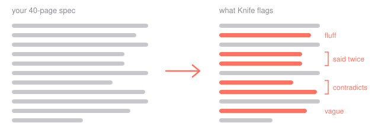

# Knife



Paste requirement docs (markdown or plain text, English) into a project. Knife cuts them into sentence-sized chunks and shows duplicates, contradictions and dangling chunks across everything in the project. You or your agent delete the slop. No AI inside.

What it should do and why: [docs/requirements.md](docs/requirements.md).

## Run

Needs Node 24.4.1 (`.nvmrc`), pnpm and Docker.

```sh
pnpm install
pnpm linters:up   # Vale, textlint, proselint, Harper; only the Lint button needs them
pnpm dev          # Postgres + migrations + api :3000 + web :5173
```

Open http://localhost:5173 and sign in with Google. `apps/api/.env` is committed with working dev credentials.

## Agent (MCP)

Add `http://localhost:3000/mcp` as a remote MCP server, e.g.

```sh
claude mcp add --transport http knife http://localhost:3000/mcp
```

The agent opens a consent page in the browser; read and delete are granted separately. It sees exactly the projects you see.

## Check

```sh
pnpm format:check && pnpm lint:check && pnpm tsc && pnpm test
pnpm dead      # knip + jscpd
pnpm e2e       # Playwright; raises its own database, needs linters up
pnpm mutate    # Stryker over @knife/universe
```

## Layout

- `packages/universe` — the core: chunking, stemming, duplicates, search. Web and MCP both call it
- `apps/api` — NestJS + Prisma: auth, projects, chunks, MCP + OAuth
- `apps/web` — React + Vite
- `services/linters` — prose linters behind one HTTP endpoint
- `tests` — e2e scenarios
